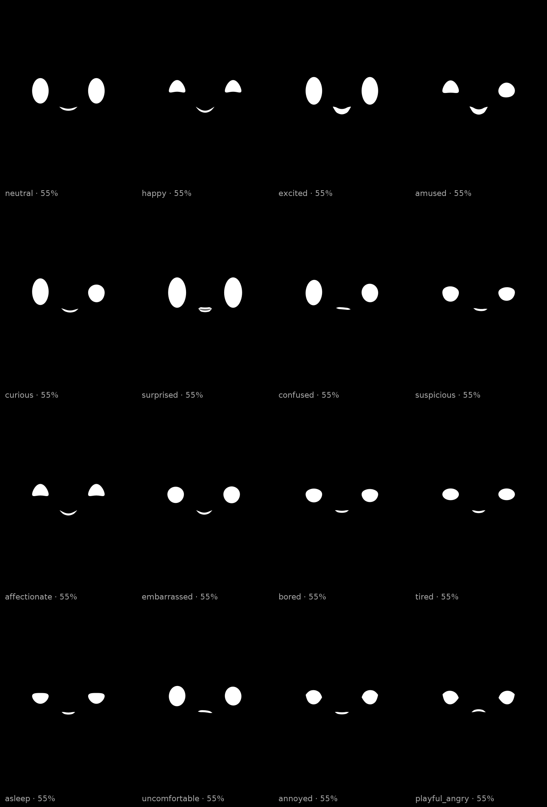
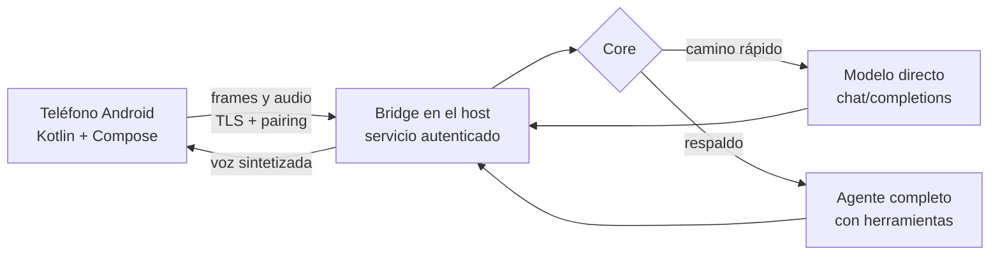

# Hermes Face

Mi agente tenía voz, pero no cara. Quería que la tuviera, y tenía un teléfono Android guardado en un cajón. Este proyecto es eso: un dispositivo dedicado que se queda encendido mostrando una cara que escucha, piensa y contesta en voz alta.

La cara no es un video ni un GIF en bucle. Son óvalos y una boca dibujados por código, con una capa de física encima que les da inercia. Parpadea, respira y se mueve sola, y cuando cambia de emoción no salta: se estira hasta llegar.

## Qué hace hoy

Le hablo y me escucha. El audio viaja al host, se transcribe, el modelo contesta, se sintetiza la voz y regresa al teléfono mientras la cara reacciona. Un turno completo, medido en un moto g20 real:

| Etapa | Tiempo |
|---|---|
| Escucha y transcripción | 3,088 ms |
| Modelo (camino directo) | 136 ms |
| Síntesis de voz | 1,517 ms |
| **Turno total** | **4,768 ms** |

## La medición que cambió el diseño

Al principio cada turno tardaba veinte segundos. El problema no era el teléfono ni la red: el *core* arrancaba un agente completo por cada frase, con su prompt, sus herramientas y su planeación. Para contestar "hola" no hace falta todo eso.

Lo cambié por una llamada directa al modelo, dejando el agente como respaldo, y medí los dos caminos con tres turnos cada uno:

| Camino | Turno 1 | Turno 2 | Turno 3 | Media |
|---|---|---|---|---|
| Agente completo | 18 898 ms | 20 160 ms | 22 778 ms | **20 612 ms** |
| Directo al modelo | 177 ms | 130 ms | 159 ms | **155 ms** |

Son 133 veces más rápido en el core. El respaldo se probó en vivo forzando una llave inválida: 17,6 s y el audio salió igual, así que si el camino rápido falla la cara no se queda muda.

De paso apareció un detalle que costó una tarde: un proveedor rechazaba las llamadas directas con 403 porque Cloudflare bloqueaba el `User-Agent` de `Python-urllib`. La solución fue ponerle un User-Agent propio a la cara.

## Arquitectura

## Tres decisiones que explican el código

**La lógica de la cara vive fuera de Android.** Geometría, física, máquina de estados y comportamiento están en un módulo sin dependencias de plataforma, así que se prueba en el host sin teléfono conectado. Ajustar una expresión no requiere instalar nada en el dispositivo, y la mayoría de las pruebas corren en segundos.

**Las emociones no las inventa el modelo.** El texto que contesta el agente pasa por un reductor que decide qué expresión corresponde según señales explícitas. Si el modelo dice algo raro, la cara no se pone a improvisar gestos.

**Los contratos son la fuente de verdad.** Los esquemas de mensajes, configuración y ejemplos viven en su propia carpeta y el código consume copias de ahí. Cuando el teléfono y el host hablan, hablan de eso, no de un acuerdo implícito que se rompe en el siguiente cambio.

## Estado y límites

En la etapa E8-D, con el pipeline de voz verificado en el host y el recorrido completo probado en el teléfono. Lo que falta está apuntado con nombre y apellido: el dispositivo aún no queda montado de forma permanente, la reconexión a media frase sigue dando guerra y el teléfono se calienta cuando lo dejas escuchando mucho rato. Nada de eso está escondido en el proyecto, es la lista de trabajo que sigue.

## Sobre el código

Repositorio de exhibición: documenta el diseño, las mediciones y las decisiones. El código de la app, del bridge y los APK no se distribuyen.

© 2026 Javier Cuevas. Todos los derechos reservados.
